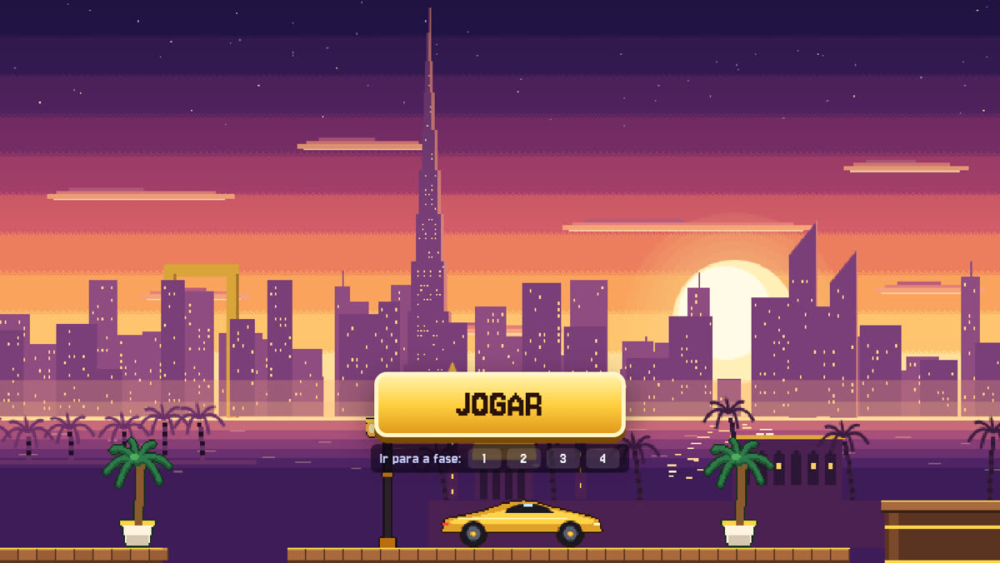

# Bicharada da Sorte

Jogo de plataforma em pixel art sobre aposta online, em desenvolvimento.

**Jogar no navegador: https://rafaklugee.github.io/bicharada-da-sorte/**

O benefício do tigre caiu e o anúncio da Fortuna Dubai promete multiplicar o dinheiro. Em quatro fases, do souk ao cassino e à cobertura, ele aposta, perde, pega fiado com o agiota e enfrenta o Tigrão de Ouro, um caça-níquel gigante. As falas mudam conforme o histórico de apostas de quem joga.

Feito com JavaScript, Three.js e Vite por [Rafael Kluge](https://rafaklugee.github.io).
